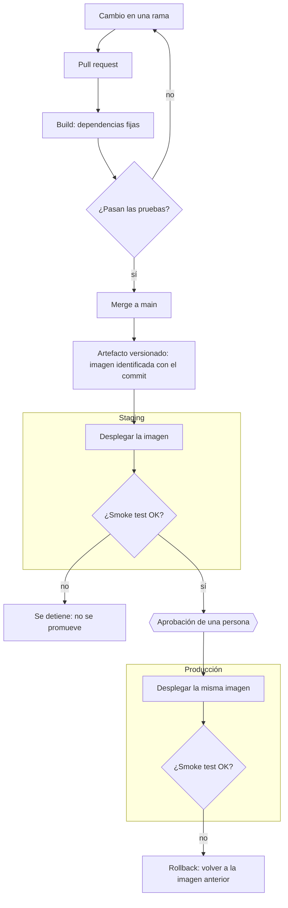

# Mapa de estrategia CI/CD - API de tareas

> Autor o autora: (nombre)
> Punto de partida: `docs/DESPLIEGUE_MANUAL.md`, el proceso manual que el pipeline va a reemplazar.
> Cómo se ve un mapa terminado: `docs/ejemplo-mapa-cicd-sitio.md` (otro caso, mismo método).
> Sintaxis de los diagramas: la Guía rápida de Mermaid (Moodle, material de apoyo).

## 1. Flujo de commit a producción

Reemplazar este esqueleto por el flujo completo: etapas, ambientes y los puntos donde decide una
persona. GitHub y la vista previa de VS Code (`Ctrl+Shift+V`) muestran el diagrama. Si queda muy
ancho, cambiar `LR` por `TD`.

## 2. Ambientes

| Ambiente | Para qué sirve | Cómo llega un cambio | Quién decide que llegue |
|---|---|---|---|
| Local | Escribir y previsualizar un artículo | Quien escribe genera el sitio en su computadora | Quien escribe |
| Staging | Ver el sitio que generó el pipeline antes de publicarlo | Automático, después del merge a `main` | Nadie: el pipeline |
| Producción | El sitio que leen los lectores | El mismo paquete que pasó por staging | Una persona del equipo editorial |

## 3. Riesgos del proceso manual y controles

Un renglón por riesgo. La columna "Paso" cita el paso de `DESPLIEGUE_MANUAL.md`.

| Paso | Riesgo | Qué puede pasar | Control del pipeline que lo atiende | Etapa del flujo |
|---|---|---|---|---|
| Antes de empezar | Se pide por chat que alguien confirme que las pruebas pasaron | Se despliega con pruebas rotas | Las pruebas corren solas en cada pull request y bloquean el merge si fallan | Pruebas |
| Antes de empezar | La clave del servidor está en un correo | Quien lea el correo entra al servidor | La credencial se guarda como secreto; solo el pipeline la usa y nadie la necesita a mano | Despliegue en staging y producción |
| 1 | Se entra al servidor por SSH como `root` | Un error a mano daña todo el servidor | Nadie entra al servidor a mano: el despliegue lo hace el pipeline, siempre con los mismos pasos | Despliegue en staging y producción |
| 2 | `git pull` en el servidor; si hay conflicto, borrar y volver a clonar | Corre un código distinto al revisado; nadie sabe qué commit está (historial, la semana pasada) | El servidor no trae código: recibe el artefacto versionado, una imagen que se construye una vez y se identifica con el commit | Artefacto versionado |
| 3 | `pip install flask gunicorn` sin versiones | Otra versión de Flask rompe la API (historial, hace 3 semanas) | Versiones fijas en `requirements.txt` y build en una máquina limpia, donde las pruebas lo detectan antes del merge | Build |
| 4 | El token está escrito en el documento y se exporta a mano | El token se filtra | El token se guarda como secreto, fuera del código; el pipeline lo entrega a la aplicación al arrancar | Despliegue en staging y producción |
| 4 a 6 | El token vive solo en la sesión SSH | La sesión se cierra antes del paso 6 y la API arranca sin token (historial, hace 2 semanas) | El pipeline entrega el token en cada arranque; no depende de que una sesión siga abierta | Despliegue en staging y producción |
| 5 | Buscar el proceso con `ps` y terminarlo con `kill -9` | Se mata otro proceso, o la versión vieja sigue corriendo | El despliegue lo hace el pipeline, siempre con los mismos pasos: nadie busca ni termina procesos a mano | Despliegue en staging y producción |
| 7 | «Si carga en el navegador, salió bien» | `/tareas` carga pero otras rutas fallan y nadie lo nota | Smoke test automático contra lo desplegado (`scripts/smoke.sh`) | Validación posterior |
| Si algo sale mal | Hay que preguntar a qué commit volver | Se vuelve a una versión equivocada, o se tarda horas | Cada artefacto queda identificado con el commit; volver (rollback) es desplegar el artefacto anterior | Artefacto versionado |

## 4. Criterios de éxito

Qué tiene que ser verdad para decir que un despliegue salió bien, de forma que una máquina lo
pueda comprobar.

- `GET /tareas` responde 200.

-

## 5. Decisiones y preguntas abiertas

- Decisión: la aprobación va después del smoke test de staging y antes de producción. Una persona decide cuando Arpueba el despliegue a produccion.
- Pregunta abierta: ¿quién aprueba si la persona revisora no está disponible?

- Uso de IA: no se usó